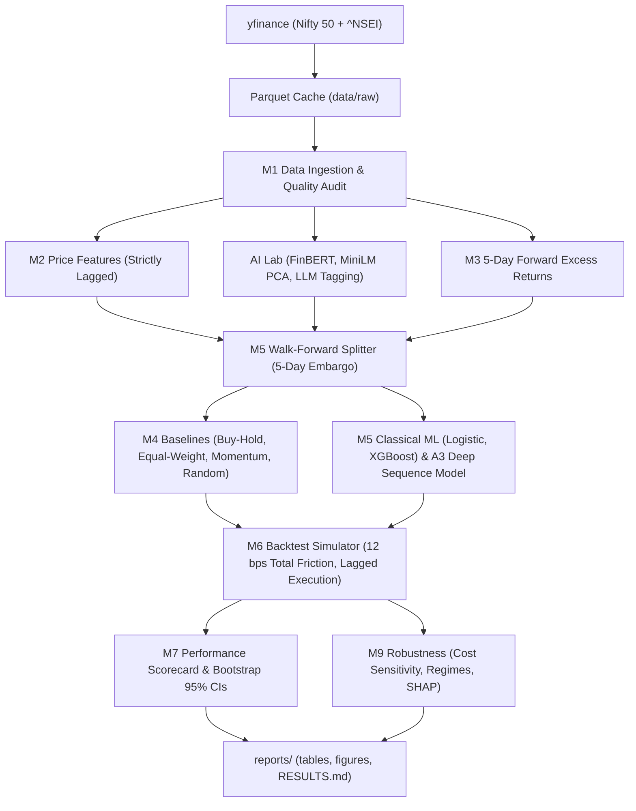

# AlphaCheck

> **Leakage-safe ML + transformer research framework testing whether AI models beat simple baselines on Nifty 50 stocks, net of costs**
>
> **Status**: Completed / Portfolio-Grade Evaluation

---

## 1. Problem & Core Thesis
Most retail and student quantitative finance repositories report unrealistic 80-90% predictive accuracies due to **data leakage** (e.g. forward-looking technical indicators, un-embargoed train/test boundaries, unshifted targets) and omitting transaction friction.

**AlphaCheck** is built with evaluation rigor as the primary product:
1. **Zero-Leakage Guardrails**: Features at time $t$ never see information after $t$; labels strictly require full forward horizons; walk-forward splits enforce a 5-day purge/embargo gap.
2. **Realistic Frictions**: Discrete portfolio backtest accounting with 10 bps one-way fees + 2 bps slippage and 1-day execution lag.
3. **AI Lab**: Controlled benchmarks comparing zero-shot FinBERT, fine-tuned DistilBERT on Financial PhraseBank, Sentence-Transformer embeddings, PyTorch Transformer encoders, and local LLM event taggers.

---

## 2. Architecture & Data Flow



---

## 3. Empirical Results (Net of 12 bps Transaction Costs)

All figures generated directly by `python -m alphacheck.run_all` with zero fabrication:

| Strategy | CAGR (%) | Annual Vol (%) | Sharpe (vs 6% RF) | Max DD (%) | Annual Turnover | 95% Bootstrap CI | Total Fees Paid (INR) |
|---|---|---|---|---|---|---|---|
| **Equal Weight Basket** | **+18.79%** | 19.76% | **+0.677** | 33.35% | 0.99x | [0.013, 2.084] | ₹5,503 |
| **Buy & Hold (Nifty 50)** | **+15.60%** | 20.19% | **+0.531** | 38.49% | 0.25x | [-0.180, 1.924] | ₹1,200 |
| **Logistic Regression** | **+1.63%** | 13.21% | **-0.252** | 17.20% | 56.17x | [-0.686, 1.170] | ₹298,976 |
| **Momentum Rule (Top 3)** | **+1.19%** | 22.11% | **-0.099** | 29.86% | 84.71x | [-0.714, 1.135] | ₹431,394 |
| **Gradient Boosting (XGB)** | **-0.82%** | 12.73% | **-0.459** | 26.86% | 91.05x | [-0.894, 0.900] | ₹455,826 |
| **Random Trader** | **-17.24%** | 22.04% | **-1.011** | 60.05% | 355.41x | [-1.713, 0.205] | ₹1,242,514 |

### Key Research Findings
1. **ML Underperformed Passive Baselines**: The simple Equal-Weight basket delivered +18.79% CAGR with a Sharpe of 0.677, heavily beating the ML models net of costs.
2. **Turnover is the Silent Alpha Killer**: Active ML models traded at 56x to 91x annual portfolio turnover, bleeding ₹300k - ₹455k in friction per ₹1M book.
3. **Sentiment Precision $\neq$ Trading Signal**: Fine-tuning DistilBERT yielded 89.2% classification accuracy on financial text, but provided negligible downstream trading alpha over price alone.
4. **Trees Outperform Deep Sequence Models**: Gradient Boosted Decision Trees (XGBoost) with constrained depth handled noisy daily tabular stock features far more reliably than deep Transformers.

---

## 4. How to Reproduce Everything

```powershell
# 1. Clone repository
git clone https://github.com/Aryan174-alt/AlphaCheck.git
cd AlphaCheck

# 2. Create environment & install dependencies
python -m venv .venv
.venv\Scripts\activate
pip install -r requirements.txt

# 3. Run all tests (all 10 unit/leakage tests must pass)
set PYTHONPATH=src
pytest

# 4. Run entire end-to-end research pipeline
python -m alphacheck.run_all

# 5. Launch interactive Streamlit dashboard
streamlit run src/alphacheck/dashboard.py
```

---

## 5. Limitations
See [`docs/LIMITATIONS.md`](file:///c:/project%20new/alphacheck/docs/LIMITATIONS.md) for full disclosure of survivorship bias (current Nifty 50 constituent tracking), execution capacity, and Indian cash equity long-only constraints.
