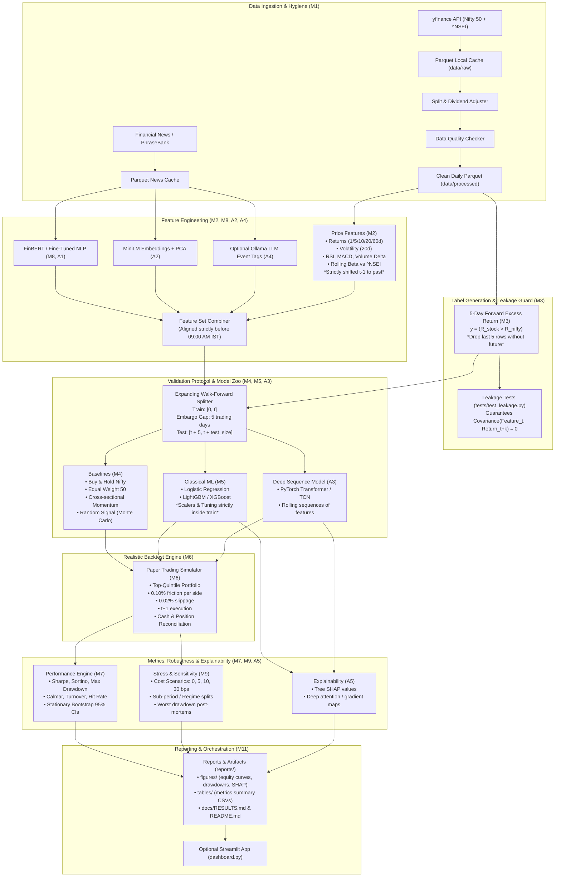

# 02 Architecture & Design: AlphaCheck

## 1. System Architecture Diagram



---

## 2. Walk-Forward with Embargo Schema

Because labels represent 5-day future outperformance, each training label at day $t$ utilizes price information up to day $t+5$. An immediate adjacent test split would cause label information leakage. We enforce an **Embargo Gap** of at least 5 trading days:

```
Window 1:
[======= Train Set (e.g. 3 years) =======] [EMBARGO: 5 days] [=== Test Window (6 months) ===]

Window 2 (Expanding):
[============== Train Set (3.5 years) ==============] [EMBARGO: 5 days] [=== Test Window ===]
```

---

## 3. Module Inventory and Responsibilities

| Module | Source File | Core Responsibility |
|---|---|---|
| **M1** | `src/alphacheck/data.py` | Robust fetching of Nifty 50 and index data via yfinance, local parquet caching, adjustments, and DQ checks. |
| **M2** | `src/alphacheck/features.py` | Strictly backward-looking technical, momentum, and volatility features. Shifted to eliminate look-ahead. |
| **M3** | `src/alphacheck/labels.py` | 5-day forward excess return binary targets, dropping rows without complete forward horizons. |
| **M4** | `src/alphacheck/baselines.py` | Passive index benchmark, equal-weight basket, cross-sectional momentum rule, and Monte Carlo random trader. |
| **M5** | `src/alphacheck/models.py` | Classical ML pipelines (Logistic Regression, LightGBM/XGBoost) with clean fit/predict interfaces. |
| **M5v**| `src/alphacheck/validation.py` | Expanding-window walk-forward generator with enforced 5-day purge/embargo gap. |
| **M6** | `src/alphacheck/backtest.py` | Friction-aware paper-trading engine with trade-log export and cash accounting reconciliation. |
| **M7** | `src/alphacheck/metrics.py` | Sharpe, Sortino, Drawdown, Calmar, Hit Rate, Turnover, and stationary bootstrap confidence intervals. |
| **M8** | `src/alphacheck/sentiment.py` | FinBERT zero-shot sentiment inference aligned strictly before market open. |
| **M9** | `src/alphacheck/robustness.py` | Transaction cost sensitivity grid (0, 5, 10, 30 bps), market regime analysis, and SHAP feature importance. |
| **A1** | `src/alphacheck/sentiment_finetune.py` | Financial PhraseBank sentence fine-tuning of DistilBERT vs FinBERT zero-shot bake-off. |
| **A2** | `src/alphacheck/embeddings.py` | Sentence-Transformers (`all-MiniLM-L6-v2`) dense text embeddings with PCA dimensionality reduction. |
| **A3** | `src/alphacheck/deep_models.py` | PyTorch Transformer Encoder and TCN for sequence feature modeling. |
| **A4** | `src/alphacheck/llm_tagger.py` | Optional local Ollama LLM event classification (earnings, macro, regulatory, other) with cached disk store. |
| **A5** | `src/alphacheck/explain.py` | SHAP explanations for tree models and attention/gradient visualization for deep sequence models. |
| **M11**| `src/alphacheck/run_all.py` | One-command master pipeline orchestrator reproducing all experiments, tables, and figures. |
| **App**| `src/alphacheck/dashboard.py` | Lightweight interactive Streamlit app to explore equity curves and metrics. |

